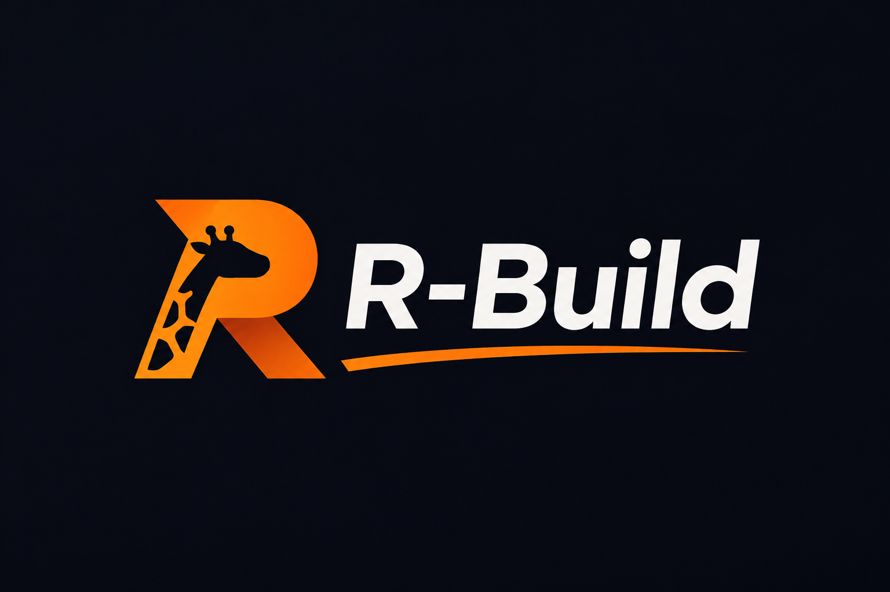
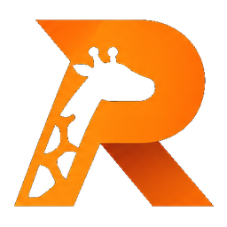

  

  
  
  

  <a href="#-français"><b>🇫🇷 Français</b></a> &nbsp;·&nbsp; <a href="#-english"><b>🇬🇧 English</b></a>

---

## 🇫🇷 Français

### Qu'est-ce que RBuild ?

**RBuild** est une application Windows qui met une **équipe d'agents IA** au service de ton jeu **Roblox**. Tu décris ce que tu veux à un **Directeur** : il te pose des questions, te propose un plan, puis répartit le travail entre des agents spécialisés. Chaque résultat est vérifié et relu avant de t'être présenté.

Les agents savent créer :

| | |
|---|---|
| 🖼️ **Interfaces** | HUD, menus, boutiques, avec un éditeur visuel intégré |
| 🎨 **Images et icônes** | générées pour ton jeu, avec fond transparent |
| 🧊 **Modèles 3D** | modélisés dans Blender puis prêts pour Roblox |
| 🏃 **Animations** | personnages R15 et objets (coffres, portes…) |
| 🔊 **Sons** | sons libres de droits trouvés, écoutés et rangés |
| ✨ **VFX** | particules, auras, impacts, à voir avant de les envoyer |
| 🧩 **Scènes et scripts** | tout assemblé et relié, puis testé en Play |

Pour les gros chantiers, la page **Gros projets** t'accompagne : un document guidé, un plan découpé en lots qui s'enchaînent tout seuls, et des revues complètes de ton jeu.

### 🛡️ Tu gardes la main

- **Rien n'est envoyé dans Roblox Studio sans toi.** Tu vois les différences, puis tu cliques sur « Envoyer vers Studio ». L'envoi automatique existe, mais il faut l'activer toi-même.
- Les envois vont sur ta **place de test**, jamais pendant une partie en cours. Un seul **Ctrl+Z** dans Studio annule un envoi.
- Les revues de ton jeu se font **en lecture seule**. Tes clés et jetons sont chiffrés sur ton PC.

### 📥 Installation

1. Télécharge **[RBuild-Setup.exe](https://github.com/lightnew10/RBuild-releases/releases/latest/download/RBuild-Setup.exe)** (environ 9 Mo).
2. Lance-le. Si Windows affiche « Windows a protégé votre ordinateur », clique sur **Informations complémentaires**, puis **Exécuter quand même**. Ce message apparaît parce que l'installateur n'a pas de certificat de signature Windows payant.
3. Suis l'installation. Si ton PC n'a pas encore **Microsoft WebView2**, l'installateur le télécharge tout seul (il faut Internet).
4. Ouvre RBuild, puis **Roblox Studio** : le plugin RBuild s'installe automatiquement. Redémarre Studio une fois s'il le demande.

### 🔄 Mises à jour automatiques

À chaque lancement, RBuild vérifie s'il existe une nouvelle version. S'il en trouve une, il la télécharge, l'installe et redémarre tout seul : **tu n'as rien à faire**. Chaque mise à jour est **signée** : RBuild refuse toute version qui ne vient pas de son auteur. Si tu es hors ligne, RBuild s'ouvre normalement.

### ⚙️ Configuration requise

- **Windows 10 ou 11**, 64 bits.
- **Roblox Studio**.
- Pour les agents IA : **Claude Code** et/ou **Codex**, installés et connectés à ton abonnement.
- Optionnel : **Blender** (modèles 3D, conversion d'animations).

### ❓ Questions fréquentes

<b>RBuild modifie-t-il mon jeu publié ?</b>

Non. RBuild ne travaille que sur une place de test, et uniquement après ton clic, ou avec l'envoi automatique si tu l'as activé.

<b>Mes données partent-elles quelque part ?</b>

Tes projets restent sur ton PC. Les agents IA passent par tes propres outils (Claude Code, Codex), avec tes abonnements.

<b>Comment désinstaller RBuild ?</b>

Paramètres Windows → Applications → RBuild → Désinstaller.

---

## 🇬🇧 English

### What is RBuild?

**RBuild** is a Windows app that puts a **team of AI agents** to work on your **Roblox** game. You tell a **Director** what you want: it asks you questions, proposes a plan, then shares the work among specialised agents. Every result is checked and reviewed before you see it.

The agents can create:

| | |
|---|---|
| 🖼️ **Interfaces** | HUDs, menus and shops, with a built-in visual editor |
| 🎨 **Images & icons** | generated for your game, with transparent backgrounds |
| 🧊 **3D models** | modelled in Blender, then ready for Roblox |
| 🏃 **Animations** | R15 characters and objects (chests, doors…) |
| 🔊 **Sounds** | royalty-free sounds, found, previewed and organised |
| ✨ **VFX** | particles, auras and impacts you can preview before sending |
| 🧩 **Scenes & scripts** | everything assembled and wired together, then tested in Play |

For larger work, the **Big projects** page guides you: a structured design document, a plan split into batches that run one after another on their own, and full reviews of your game.

### 🛡️ You stay in control

- **Nothing reaches Roblox Studio without you.** You see the differences, then click "Send to Studio". Automatic sending exists, but you have to turn it on yourself.
- Changes go to your **test place**, never while a game is running. A single **Ctrl+Z** in Studio undoes a send.
- Reviews of your game are **read-only**. Your keys and tokens are encrypted on your PC.

### 📥 Installation

1. Download **[RBuild-Setup.exe](https://github.com/lightnew10/RBuild-releases/releases/latest/download/RBuild-Setup.exe)** (about 9 MB).
2. Run it. If Windows shows "Windows protected your PC", click **More info**, then **Run anyway**. This message appears because the installer has no paid Windows code-signing certificate.
3. Follow the installer. If your PC doesn't have **Microsoft WebView2** yet, the installer downloads it for you (Internet required).
4. Open RBuild, then **Roblox Studio**: the RBuild plugin installs itself. Restart Studio once if asked.

### 🔄 Automatic updates

Every time it starts, RBuild checks for a new version. If one exists, it downloads it, installs it and restarts on its own: **you have nothing to do**. Every update is **signed**: RBuild rejects any version that doesn't come from its author. When you're offline, RBuild simply opens as usual.

### ⚙️ Requirements

- **Windows 10 or 11**, 64-bit.
- **Roblox Studio**.
- For the AI agents: **Claude Code** and/or **Codex**, installed and signed in to your subscription.
- Optional: **Blender** (3D models, animation conversion).

### ❓ FAQ

<b>Does RBuild change my published game?</b>

No. RBuild only works on a test place, and only after you click, or with automatic sending if you turned it on.

<b>Does my data go anywhere?</b>

Your projects stay on your PC. The AI agents run through your own tools (Claude Code, Codex), on your own subscriptions.

<b>How do I uninstall RBuild?</b>

Windows Settings → Apps → RBuild → Uninstall.

---

   
  © 2026 RBuild — Tous droits réservés / All rights reserved. RBuild n'est pas affilié à Roblox Corporation. / RBuild is not affiliated with Roblox Corporation.

